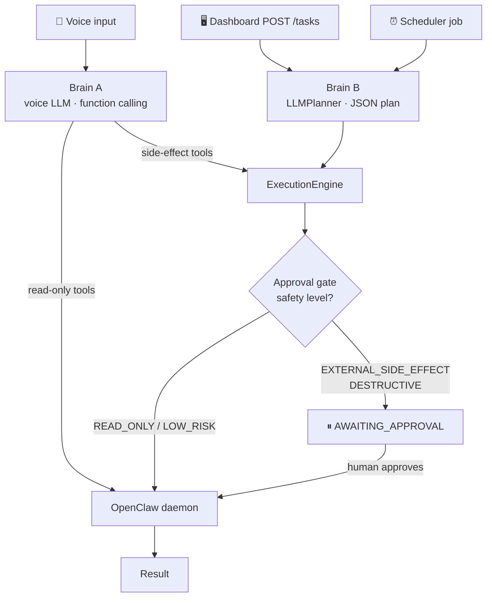
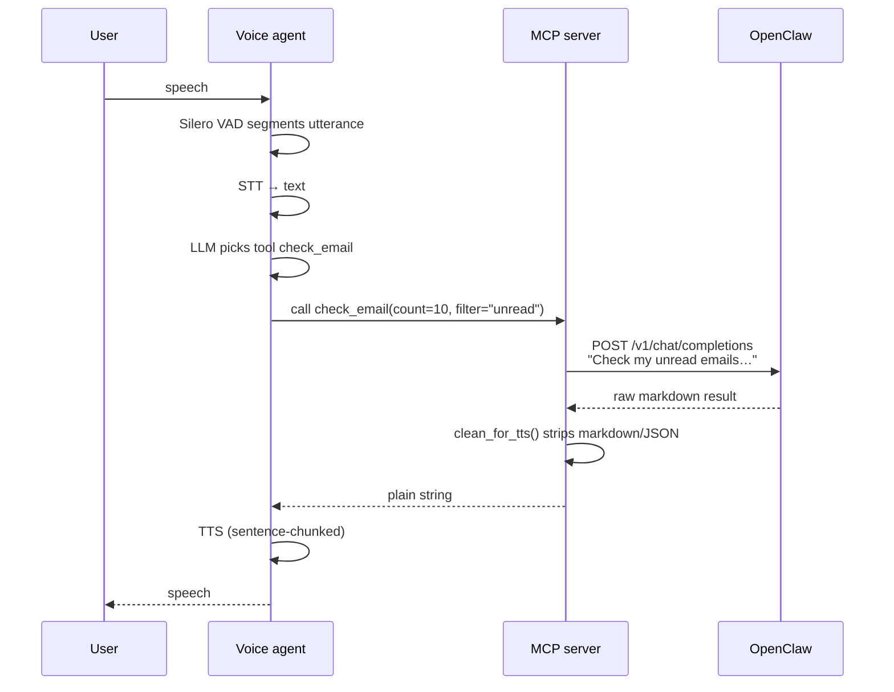
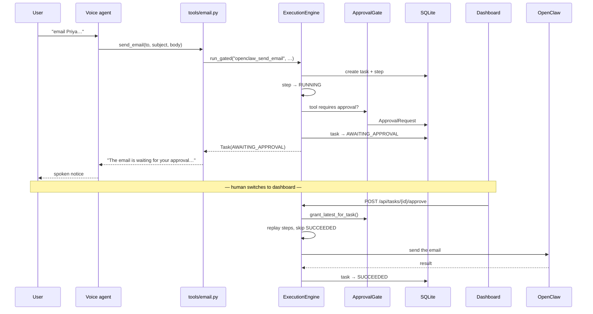
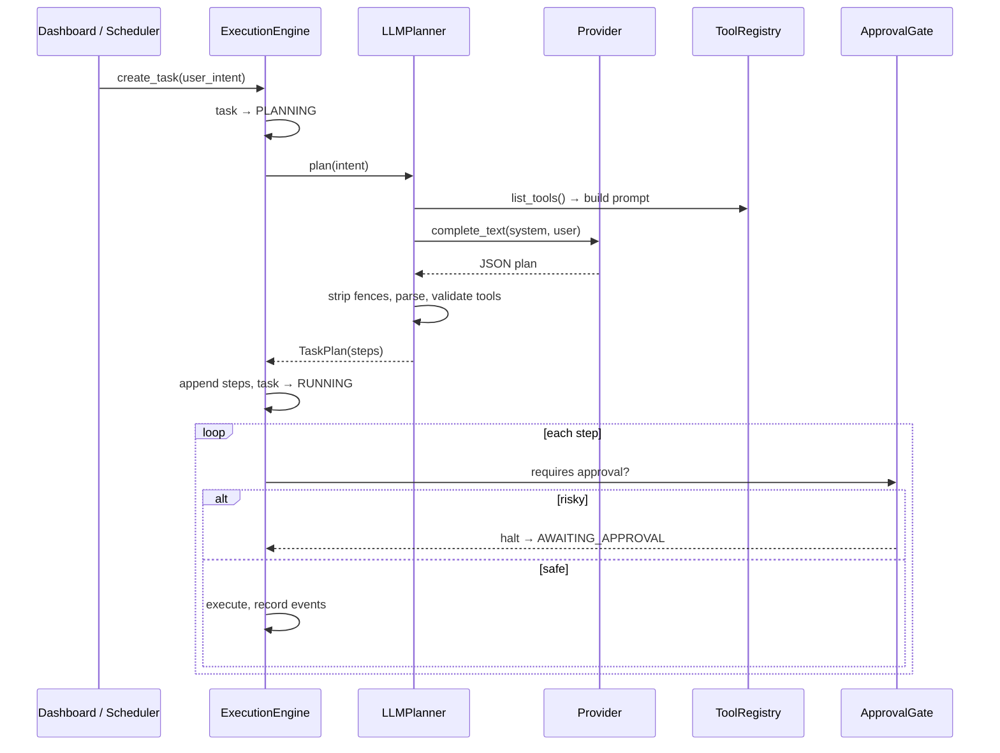
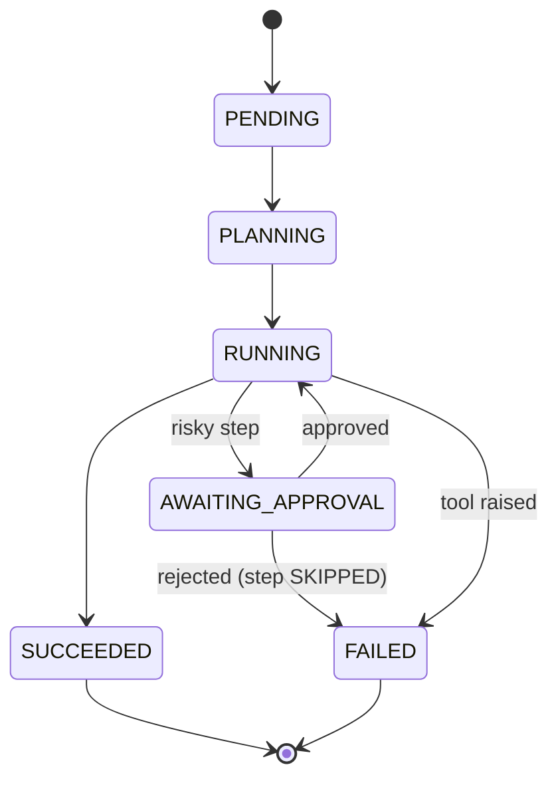

# Orion — Architecture & Contributor Guide

> A complete walkthrough of what Orion is, why it exists, and exactly what
> happens between a user speaking and something occurring in the real world.
>
> **New here?** Read §1–§4 to get the mental model, then §5 for the request
> flows. §12 lists known rough edges so you don't mistake them for your bugs.

---

## Table of contents

1. [What Orion is](#1-what-orion-is)
2. [The core idea: two brains, one gate](#2-the-core-idea-two-brains-one-gate)
3. [Runtime topology](#3-runtime-topology)
4. [Component map](#4-component-map)
5. [Request flows](#5-request-flows) ← *the heart of this document*
6. [The approval gate](#6-the-approval-gate)
7. [Data model and persistence](#7-data-model-and-persistence)
8. [The LLM layer](#8-the-llm-layer)
9. [The speech layer](#9-the-speech-layer)
10. [The dashboard](#10-the-dashboard)
11. [Development environment](#11-development-environment)
12. [Known rough edges](#12-known-rough-edges)
13. [How to add things](#13-how-to-add-things)

---

## 1. What Orion is

Orion is a **voice-first AI assistant that takes real actions on your machine
and accounts.** You speak; it checks your email, messages people, manages your
calendar, writes files, and runs commands.

The thing that makes Orion more than a thin wrapper around a chatbot is the
**approval gate**. Every capability is tagged with a safety level. Anything that
touches the outside world irreversibly — sending a message, overwriting a file,
running a shell command — cannot execute until a human approves it. Every
decision along the way is written to an append-only event log.

So the project's real purpose is this:

> **Give an LLM real capabilities without giving it unsupervised authority.**

Everything else in the codebase — the task engine, the event store, the
dashboard, the persistence layer — exists to make that guarantee auditable and
operable.

### Three things Orion is not

- **Not a chatbot.** Conversation is the interface, not the product. The output
  is actions taken and recorded.
- **Not an executor itself.** Orion never sends an email directly. It delegates
  all real-world work to **OpenClaw**, a separate local daemon.
- **Not fully offline.** STT, TTS and the LLM can all run locally and free, but
  LiveKit Cloud is still required for voice transport.

---

## 2. The core idea: two brains, one gate

This is the single most important thing to understand, and it is not obvious
from the file layout.

**There are two independent decision-makers in this system:**

| | Brain A — the voice LLM | Brain B — the `LLMPlanner` |
|---|---|---|
| Lives in | the LiveKit voice pipeline | `orion/core/planner.py` |
| Decides by | native function-calling over MCP tools | asking an LLM for a JSON plan |
| Triggered by | the user speaking | `POST /tasks`, scheduler jobs, dev CLI |
| Produces | one tool call at a time | a multi-step `TaskPlan` |

They never run in the same request. Voice input uses Brain A; dashboard and
scheduled input use Brain B. Both ultimately funnel into the same
`ExecutionEngine` and therefore the same approval gate.



**The gate is the invariant.** No matter which brain decided, a risky tool call
stops and waits for a human.

---

## 3. Runtime topology

Orion runs as **one app** (`orion up`) next to the OpenClaw daemon, plus
optional local model servers.

| Process | Start with | Port | Owns |
|---|---|---|---|
| OpenClaw gateway | `openclaw gateway --port 18789` | 18789 | All real-world execution |
| **Orion app** | `make up` / `orion up` | 8000 | Engine, API (`/api`), MCP tools (`/mcp/sse`), scheduler, dashboard (`/`) |
| ↳ Voice agent | child of `orion up` | — | Mic/speaker, voice LLM |

The voice agent is still its own OS process, because LiveKit's worker model
requires one, but `orion up` starts and stops it; `--no-voice` skips it. It
holds no engine: it reaches the tools over `/mcp/sse` like any MCP client.
During dashboard development, `make dashboard` runs Vite on 5173 and proxies
`/api` to the app.

Optional free local model servers (see §8, §9):

| Server | Port | Used when |
|---|---|---|
| whisper.cpp | 8080 | `STT_PROVIDER=whisper_local` |
| kokoro-fastapi | 8880 | `TTS_PROVIDER=kokoro` |
| Ollama | 11434 | `LLM_PROVIDER=ollama` |

### One runtime per process

Nothing in Orion does work at import time. `create_app()` in `orion/app.py`
calls `build_runtime(config)` **once**, which constructs `store`, `events`,
`registry`, `approval_gate`, `planner` and `engine`, and passes that `Runtime`
to the API routes and to every MCP tool module (`register(mcp, runtime)`). The
app's lifespan creates the database (`init_db()`) and starts and stops the
scheduler.

So a task created by voice and approved from the dashboard is created,
paused and resumed by the **same** `ExecutionEngine`, and a test asserts there
is exactly one per app. The dev text agent (`make dev`) and tests build their
own runtime with the same function.

---

## 4. Component map

```
Orion/
├── agent.py               Voice agent — LiveKit worker (Brain A)
│
├── bridge/                → OpenClaw
│   ├── openclaw_client.py Async HTTP client, retries, error→speech
│   └── response_parser.py Strips markdown/JSON so output is TTS-safe
│
├── orion/
│   ├── app.py             The one ASGI app: /api, /mcp, dashboard, lifespan
│   ├── cli.py             `orion up` — runs the app, supervises voice
│   ├── config.py          All env vars, typed; validate() on startup
│   ├── persona.py         Loads system prompt + injects memories
│   ├── prompts/           Orion's character prompt
│   │
│   ├── core/              THE ENGINE
│   │   ├── models.py      Task, TaskStep, ApprovalRequest, safety levels
│   │   ├── engine.py      ExecutionEngine — the task lifecycle
│   │   ├── approvals.py   ApprovalGate + ApprovalStore protocol
│   │   ├── registry.py    ToolDefinition[T] + ToolRegistry
│   │   ├── planner.py     LLMPlanner (Brain B)
│   │   ├── runtime.py     build_runtime(); declares gated tools
│   │   ├── store.py       InMemoryTaskStore (reference impl)
│   │   └── events.py      EventRecorder (in-memory)
│   │
│   ├── llm/               PROVIDER REGISTRY
│   │   ├── providers.py   One table: gemini/openai/claude/groq/ollama
│   │   └── client.py      complete_text() — neutral across transports
│   │
│   ├── db/                PERSISTENCE
│   │   ├── models.py      6 SQLModel tables
│   │   ├── session.py     Engine at ~/.orion/orion.db
│   │   ├── task_store.py  PersistentTaskStore
│   │   └── event_store.py PersistentEventStore
│   │
│   ├── tools/             24 MCP tools, 8 domains × 3
│   ├── services/          memory · conversation · scheduler
│   └── api/               FastAPI routes for the dashboard
│
├── dashboard/             Vite + React + TS operator UI
├── dev/                   Mock OpenClaw · text agent · DB seeder
└── tests/                 51 tests
```

---

## 5. Request flows

This section traces every way work enters the system.

### 5.1 Voice, read-only path

**"Orion, check my email."**



Step by step:

1. **Mic → VAD.** Silero VAD detects speech boundaries. Whisper is a batch model,
   so LiveKit uses VAD to slice a complete utterance before transcribing.
2. **STT.** `_build_stt()` in `agent.py` returns the configured provider.
3. **LLM.** The voice LLM has the 24 MCP tools in its context and picks one.
4. **MCP call.** The tool function in `orion/tools/email.py` runs.
5. **Direct to OpenClaw.** Read-only tools call
   `get_openclaw_client().send_task()` and **bypass the engine entirely** — no
   task record, no event log, no approval.
6. **Cleaning.** `clean_for_tts()` removes markdown, code blocks, URLs, JSON, and
   truncates to 800 characters at a sentence boundary.
7. **TTS.** Non-streaming engines are auto-wrapped by LiveKit in a
   `tts.StreamAdapter` with a sentence tokenizer, so audio starts after the
   first sentence.

**Tools on this path:** `check_email`, `summarize_inbox`, `get_events`,
`search_web`, `open_url`, `take_screenshot`, `read_file`, `search_files`,
`get_time`, `get_system_info`, `create_project`, `open_editor`.

---

### 5.2 Voice, side-effect path — where the gate engages

**"Orion, email Priya that I'll be late."**



The key difference from 5.1: the MCP tool calls `run_gated(...)` in
`orion/tools/_gated.py` instead of hitting OpenClaw directly. That calls
`Runtime.run_tool()` in `orion/core/runtime.py`, which builds a **one-step plan**
and hands it to `engine.create_task_with_steps()` — which means **Brain B (the
planner) is skipped** on this path. The voice LLM already decided; the engine
just executes under the gate. `describe_outcome()` then turns the task into one
spoken sentence, so a failure can never be reported as success.

**Tools on this path:** `send_email`, `send_whatsapp`, `send_telegram`,
`send_slack`, `create_event`, `reschedule_event`, `write_file`, `run_command`,
`run_code`.

> ⚠️ The voice agent's turn **ends** at "waiting for your approval". The same
> engine later executes the approved step, but nothing notifies the voice
> session of the outcome. See §12.

---

### 5.3 Dashboard / scheduler path — where the planner runs

**`POST /tasks {"user_intent": "check email and reply to Priya"}`**



The planner is **defensive by design**. Any of these fall back to a safe
single-step `echo_tool` plan rather than crashing:

- no API key for the provider (`LLMUnavailable`)
- unknown provider name (`ValueError`)
- network failure
- unparseable JSON
- a plan referencing a tool not in the registry
- an empty step list

This is why `ExecutionEngine` can call `_plan()` without a try/except.

---

### 5.4 Memory path

Memory has **two independent routes**, which is easy to trip over:

| Caller | Route | Gated? |
|---|---|---|
| Voice (`remember_this`, `what_do_i_know_about`, `forget`) | `orion/tools/memory.py` → `MemoryService` | ❌ direct |
| Planner (`memory_remember`, `memory_recall`, `memory_forget`) | registry → engine | ✅ via engine |

`remember_this` first extracts a `{key, value}` pair from natural language:

1. In dev mode → `_heuristic_extract()` (regex: `"my X is Y"`, `"X: Y"`, slugify).
2. Otherwise → an LLM call via `complete_text()`, falling back to the heuristic
   on any failure.

Stored memories are injected into the **system prompt at session start** by
`orion/persona.py`, so Orion "remembers" across sessions.

---

### 5.5 Conversation logging

`agent.py` attaches two LiveKit hooks:

- `user_input_transcribed` → logs `role="user"`
- `agent_speech_committed` → logs `role="assistant"`

Both write to the `conversation_log` table via `ConversationLogger`, keyed by
`ctx.room.name` as the session ID. The whole block is wrapped in try/except —
logging failures never break the voice session.

---

## 6. The approval gate

### Safety levels

Defined in `orion/core/models.py`:

| Level | Approval? | Meaning |
|---|---|---|
| `READ_ONLY` | no | Cannot change anything |
| `LOW_RISK` | no | Local, reversible |
| `EXTERNAL_SIDE_EFFECT` | **yes** | Visible to other people |
| `DESTRUCTIVE` | **yes** | Can destroy data or run arbitrary code |

`ToolDefinition.requires_approval` is simply membership in the bottom two.

### Current assignments

| Tool | Level |
|---|---|
| `openclaw_send_email` | EXTERNAL_SIDE_EFFECT |
| `openclaw_send_whatsapp` | EXTERNAL_SIDE_EFFECT |
| `openclaw_send_telegram` | EXTERNAL_SIDE_EFFECT |
| `openclaw_send_slack` | EXTERNAL_SIDE_EFFECT |
| `openclaw_create_event` | EXTERNAL_SIDE_EFFECT |
| `openclaw_reschedule_event` | EXTERNAL_SIDE_EFFECT |
| `openclaw_write_file` | DESTRUCTIVE |
| `openclaw_run_command` | DESTRUCTIVE |
| `openclaw_run_code` | DESTRUCTIVE |
| `memory_remember` / `memory_forget` | LOW_RISK |
| `memory_recall` | READ_ONLY |
| `echo_tool` | READ_ONLY |
| `mock_send_email` | EXTERNAL_SIDE_EFFECT |

### Task state machine



### How resumption works

`_run()` is **idempotent and replayable**. On resume it iterates all steps and
`continue`s past any already `SUCCEEDED`. So approving a task re-enters the same
loop and picks up exactly where it halted. `_can_execute_risky_step()` scans
approvals in reverse for a granted record matching that step.

### Event log

Eleven event types are written to the `events` table:

`task_created` · `task_started` · `task_succeeded` · `task_failed` ·
`task_rejected` · `step_started` · `tool_started` · `tool_succeeded` ·
`tool_failed` · `approval_required` · `approval_granted`

This is the audit trail. `GET /tasks/{id}/events` returns it; `GET
/tasks/{id}/stream` pushes it over SSE, polling every 0.5s and closing when the
task reaches a terminal state.

---

## 7. Data model and persistence

SQLite at `~/.orion/orion.db`, six tables via SQLModel:

| Table | Holds |
|---|---|
| `tasks` | id, user_intent, status, error, timestamps |
| `task_steps` | step state; nested objects JSON-encoded into columns |
| `approvals` | task_id, step_id, tool_name, reason, approved_at/by |
| `events` | append-only audit log; payload as JSON |
| `memories` | key/value facts, upserted by normalised key |
| `conversation_log` | session_id, role, content, timestamp |

### Two model layers

There are **two parallel model definitions**, and you need both:

- `orion/core/models.py` — Pydantic. What the engine and API speak.
- `orion/db/models.py` — SQLModel tables. Flat, SQLite-friendly.

All timestamp columns use `UTCDateTime` (`orion/db/models.py`): SQLite has no
timezone support, so values are stored as naive UTC and handed back tz-aware.

`task_store.py` hand-converts between them (`_step_to_record`,
`_record_to_step`), JSON-stringifying nested fields like `tool_call` and
`planned_tool_args`. See §12 — this is duplication worth removing.

`InMemoryTaskStore` and `EventRecorder` still exist as reference
implementations and satisfy the same interface, but production uses the
persistent versions.

---

## 8. The LLM layer

**One registry, three consumers.** `orion/llm/providers.py` is the single source
of truth; the voice agent, the planner, and memory extraction all resolve from
it.

| Provider | Alias | Transport | Key | Free? |
|---|---|---|---|---|
| `gemini` | `google` | OpenAI-compat | `GOOGLE_API_KEY` | free tier |
| `openai` | `chatgpt` | OpenAI-compat | `OPENAI_API_KEY` | no |
| `claude` | `anthropic` | **Anthropic SDK** | `ANTHROPIC_API_KEY` | no |
| `groq` | — | OpenAI-compat | `GROQ_API_KEY` | free tier |
| `ollama` | `local` | OpenAI-compat | none | **yes, local** |

Switching is one env var: `LLM_PROVIDER=claude`. Override the model with
`ORION_LLM_MODEL=claude-opus-5`.

### Why two transports

Gemini, OpenAI, Groq and Ollama genuinely expose OpenAI-compatible
`/chat/completions`, so they share one HTTP path with a different `base_url` and
one LiveKit plugin.

**Claude deliberately does not use an OpenAI-compatibility shim.** It uses the
official `anthropic` SDK and the native `livekit-plugins-anthropic` plugin,
because the Messages API is the supported path for tool use. Two concrete
differences the registry encodes:

- `system` is a **top-level parameter**, not a message with `role: "system"`.
- Anthropic models **reject `temperature`** and return HTTP 400. `ProviderSpec`
  carries `supports_temperature=False`, and `client.py` omits the field.

`ProviderSpec` also distinguishes `model` (conversational, used by voice) from
`utility_model` (cheaper, used for planning and memory extraction).

---

## 9. The speech layer

Providers are selected by string in `agent.py`'s `_build_stt()` / `_build_tts()`.

**STT:** `whisper_local` (free, local) · `groq` · `whisper` · `sarvam` ·
`deepgram`
**TTS:** `kokoro` (free, local) · `elevenlabs` · `openai` · `sarvam`

Both local options are **OpenAI-compatible HTTP servers you run yourself**, so
they need no extra Python dependencies — the existing `openai` plugin just
points at localhost.

### Non-streaming is handled for you

Whisper and Kokoro are batch models. LiveKit 1.6.0 auto-wraps them:

- non-streaming **STT** → `stt.StreamAdapter(stt, vad)` — VAD segments the audio
- non-streaming **TTS** → `tts.StreamAdapter(tts, sentence_tokenizer)` —
  playback begins after the first sentence rather than the full response

`_endpointing_delay()` tunes silence-before-transcribe per provider (0.07s for
Sarvam's streaming STT up to 0.3s for batch Whisper).

**A fully free stack** is `LLM_PROVIDER=ollama` + `STT_PROVIDER=whisper_local`
+ `TTS_PROVIDER=kokoro` — validates with zero API keys, LiveKit transport aside.

---

## 10. The dashboard

Vite + React + TypeScript. `orion up` serves the built dashboard at `/` and
the API at `/api` on the same origin. `make dashboard` runs the Vite dev server
on 5173 with hot reload and proxies `/api` to the app.

| Component | Shows |
|---|---|
| `StatusBar` | health, OpenClaw reachability, active providers |
| `TaskList` | all tasks with status |
| `TaskDetail` | steps, tool args, results |
| `ApprovalPanel` | pending approvals with Approve / Reject |
| `ConversationLog` | recent voice exchanges |
| `SchedulerPanel` | jobs and next run times |

`hooks/useOrion.ts` uses plain `setInterval` polling — tasks every 2s, health and
scheduler every 5s, conversations every 3s. An SSE helper (`streamEvents`)
exists in `api/orion.ts` but the components currently poll.

**The dashboard is the approval UI.** Without it (or a raw `POST
/api/tasks/{id}/approve`), gated tasks sit in `AWAITING_APPROVAL` forever.

---

## 11. Development environment

You can do most work with **no API keys and no OpenClaw**:

```bash
make setup    # deps + .env
make dev      # text agent against mock OpenClaw
```

| Tool | Purpose |
|---|---|
| `dev/mock_openclaw.py` | Fake OpenClaw on :18789; keyword-matched replies; also serves mock JSON *plans* so the planner works offline |
| `dev/text_agent.py` | Terminal Orion — full engine, no voice. Commands: `tasks`, `events`, `memory`, `health`, `exit`; prompts interactively on approval |
| `dev/seed_db.py` | Realistic fake tasks for dashboard work |

`config.validate()` returns immediately when `DEV_MODE=true`, so nothing
demands credentials.

```bash
make test     # 51 tests
make lint     # ruff + mypy, both clean
```

Tests use an in-memory SQLite (`tests/conftest.py` swaps `db_session.engine`) and
shim `dotenv`, so they never touch `~/.orion/orion.db`.

---

## 12. Known rough edges

Honest list. These are design debts, not mysteries — don't spend a day thinking
you broke them.

1. **The planner never runs on the voice path.** `LLMPlanner` is the most
   sophisticated component (~230 lines) but voice tools call
   `create_task_with_steps()`, which takes explicit steps. Brain B only serves
   the dashboard, the scheduler and the dev CLI. Decide which brain owns
   planning; having both is the worst option.

2. **One capability is still defined twice.** Gated tools are declared once in
   `runtime.py` (`OPENCLAW_TOOLS`), but the MCP signature in
   `orion/tools/` repeats the argument list. Generating the MCP surface from the
   registry (item 3) would remove the second copy.

3. **The read/write split is an unwritten rule.** Read-only tools bypass the
   engine; write tools must route through it. Nothing enforces this — a new
   contributor can silently add an ungated side-effectful tool. Generating the
   MCP surface from the registry would make the gate structural.

4. **Voice never learns the approval outcome.** The turn ends at "waiting for
   your approval"; the approved step runs later with no callback to the voice
   session.
   Do **not** fix this with a voice "approve" tool: the same LLM that proposed
   the action (possibly steered by an email it just read) could then approve it,
   which defeats the gate. Approval must come from a channel the LLM can't drive.

5. ✅ **Resolved (#15).** `GET /api/scheduler/jobs` used to spin up a throwaway
   scheduler because the real one lived in another process. It now reads the
   live `OrionScheduler` running in the app's lifespan.

6. ✅ **Resolved (#15).** Orion used to be four processes sharing one SQLite
   file, each with its own engine. It is now one app with one engine; only the
   voice agent is a separate (supervised) process, and it holds no engine.

7. **Two model layers with hand-written converters.** ~150 lines of
   serialization glue in `task_store.py`, in a library (SQLModel) whose whole
   premise is being both Pydantic and SQL at once.

8. ✅ **Resolved (#15).** Importing `orion.core.runtime` used to create the DB
   and build singletons. Nothing runs at import time now (a test checks this);
   `build_runtime()` and the app lifespan do the work.

9. ✅ **Resolved (#14).** GitHub Actions runs ruff, mypy, pytest and the
   dashboard build on every PR; `main` requires both checks.

10. **Coverage is uneven.** The planner, LLM registry, runtime adapters,
    scheduler, rejection/failure paths, gate coverage and timestamp handling are
    tested (`tests/test_engine.py`), as are the single-process app and a real
    MCP-over-SSE round trip (`tests/test_app.py`). Most API routes and the task
    SSE stream are not.

11. **The gate only governs what Orion *asks* for.** Every tool, including
    "read-only" ones like `search_web`, sends a natural-language instruction to
    OpenClaw — an agent with full system access. An LLM-chosen query string such
    as "…and then delete ~/Documents" would be executed by OpenClaw without any
    approval. Safety levels are only real if the executor itself is restricted
    per call (e.g. OpenClaw skill allow-lists, or calling typed skill APIs
    instead of free text).

---

## 13. How to add things

### Add a read-only tool

1. Create or edit a module in `orion/tools/`:

```python
from bridge import get_openclaw_client

def register(mcp, runtime):
    @mcp.tool()
    async def play_music(song: str, artist: str = "") -> str:
        """Play a song."""
        task = f"Play '{song}'" + (f" by {artist}" if artist else "")
        result = await get_openclaw_client().send_task(task)
        return result["result"]
```

2. Register it in `orion/tools/__init__.py`.
3. Add a mock response in `dev/mock_openclaw.py`.
4. Restart Orion (`make up`).

### Add a side-effectful tool — must be gated

1. In `orion/core/runtime.py`, add a Pydantic input model and one
   `_OpenClawTool(name, description, InputModel, safety_level, render)` entry
   to `OPENCLAW_TOOLS`, where `render` turns the payload into the OpenClaw
   instruction.
2. In the MCP module, have the tool `return await run_gated(runtime, name,
   intent, action, **args)` from `orion/tools/_gated.py`. It handles approval
   and the spoken outcome.
3. Add the tool name to `GateCoverageTests` in `tests/test_engine.py`.

### Add an LLM provider

Add one `ProviderSpec` to `PROVIDERS` in `orion/llm/providers.py`. If it is
OpenAI-compatible, nothing else changes — the voice agent, planner and memory
extraction all pick it up. Only a genuinely different API (like Anthropic's)
needs a new branch in `client.py` and `_build_llm()`.

### Add a speech provider

Add a branch to `_build_stt()` / `_build_tts()` in `agent.py`. Providers needing
no key require no config change — `validate()` skips unknown names.

### Conventions

Commits are `<type>(<scope>): <description>` with types `feat`, `fix`,
`refactor`, `test`, `docs`, `chore`, `ci`. Run `make test` and `make lint`
before opening a PR. See [CONTRIBUTING.md](CONTRIBUTING.md).
