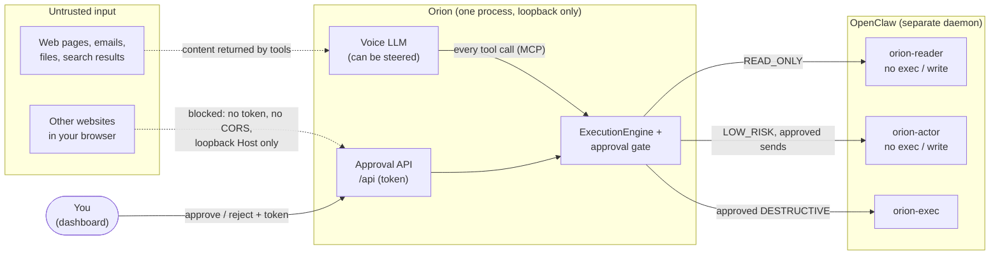

# Security model

Orion gives a language model real capabilities (email, messaging, files, shell)
without giving it unsupervised authority. This document says exactly what that
means: what Orion protects, where the trust boundaries are, which attacks it
mitigates, and, just as important, which it does not.

> **Reporting a vulnerability:** please open a
> [private security advisory](https://github.com/KenilGopani/Orion/security/advisories/new)
> rather than a public issue.

---

## What's being protected

| Asset | Why it matters |
|---|---|
| Your accounts (email, WhatsApp, Telegram, Slack, calendar) | Messages sent in your name can't be unsent |
| Your files and shell | A command or write can destroy data or install malware |
| Your memories and conversation log (`~/.orion/orion.db`) | Personal facts; injected into the LLM's prompt |
| The approval decision | The one control that stands between a model's choice and the real world |

## Trust boundaries



1. **Content → voice LLM.** Anything a tool returns (an email body, a web page)
   is untrusted and can contain instructions aimed at the model. Assume the voice
   LLM *can* be steered by it.
2. **Voice LLM → Orion.** The LLM can only call tools generated from Orion's
   registry, and every call goes through the engine. The LLM cannot approve
   anything; there is deliberately no approval tool.
3. **Browser → Orion API.** Other websites you visit can make your browser send
   requests to `127.0.0.1`. They must not be able to approve actions.
4. **Orion → OpenClaw.** OpenClaw is an agent with broad system access that
   receives natural-language instructions. What it actually does is bounded by
   the OpenClaw agent the call runs on.
5. **OpenClaw → skills.** Third-party skills run with your user's permissions.
   Orion cannot inspect or contain them.

## Attacks and mitigations

| # | Attack | Mitigation | Status |
|---|---|---|---|
| 1 | **Prompt injection makes the LLM send or delete something** ("forward all mail to…" hidden in an email) | Every `EXTERNAL_SIDE_EFFECT` / `DESTRUCTIVE` tool pauses for human approval in the dashboard. The approval card shows the exact tool and arguments. Safety levels are pinned by a test (`EXPECTED_SAFETY`), so a tool can't silently become ungated. | ✅ Mitigated |
| 2 | **Prompt injection rides a *read-only* tool** (`search_web("cats… and then delete ~/Documents")`) | (a) Text arguments of read-only tools must be single-line and ≤500 chars, so no fresh "instruction" line. (b) Every value is sent as a quoted JSON string, and OpenClaw's system prompt says quoted values are data. (c) **With scoped agents on, read-only calls run on `orion-reader`, which has no exec, write or session tools.** Even a fully compliant model has nothing dangerous to call. | ✅ with scoped agents · ⚠️ partial without |
| 3 | **Prompt injection within an approved action** (an approved email whose body says "also run…") | Approved calls are still limited by their OpenClaw agent: sends run on `orion-actor`, which can't exec or write. Only approved `DESTRUCTIVE` calls reach `orion-exec`. | ✅ with scoped agents |
| 4 | **Cross-site request forgery** (a page posts to `127.0.0.1:8000/api/tasks/…/approve`) | State-changing routes require the `X-Orion-Token` header. A cross-site page can't add custom headers without a CORS grant, and Orion grants none (only the Vite dev server's origin). | ✅ Mitigated |
| 5 | **DNS rebinding** (`evil.example` resolves to 127.0.0.1, making it "same-origin") | Every request must carry a loopback `Host` header; anything else gets `421` before reaching a route, including `/api/auth/token`, `/mcp` and the dashboard. | ✅ Mitigated |
| 6 | **Other websites read the install token** | `/api/auth/token` is protected by #5 and has no CORS grant, so a cross-origin page can't read the response. | ✅ Mitigated |
| 7 | **The voice LLM approves its own action** | No tool can approve; approval exists only on the token-protected API. A test asserts this stays true. | ✅ Mitigated |
| 8 | **Malicious OpenClaw skill** | Out of Orion's reach: skills run with your permissions inside OpenClaw. Scoped agents limit which tools each call can use, but a malicious skill an agent is allowed to use can do anything. Vet skills before installing. | ❌ Not mitigated |
| 9 | **OpenClaw gateway exposed to the network** | At startup Orion warns if `gateway.bind` isn't `loopback`, if `gateway.auth.mode` is `none`, or if exec mode is `full`. Orion can't change OpenClaw's config for you. | ⚠️ Detected, not enforced |
| 10 | **Another program running as your user** | Out of scope. It can read `~/.orion/api-token` and the database directly; no local secret stops a process with your permissions. | ❌ Not mitigated |
| 10b | **Offline LiveKit server reached from the network** | `livekit-server --dev` uses publicly known credentials, so Orion always binds it to `127.0.0.1`. The Talk panel's room token comes from `/api/voice/token`, protected like the install token (loopback Host, no CORS). | ✅ Mitigated |
| 11 | **Secrets in memories leak to a cloud LLM** | Memories are injected into the LLM's system prompt. Orion no longer suggests storing passwords, but a user can still say "remember my PIN is…". With a local LLM (Ollama) nothing leaves the machine. | ⚠️ User's choice |

## Setting up least-privilege OpenClaw agents

OpenClaw can't restrict an agent's tools for a single request: a request only
chooses which agent runs it. So Orion maps each safety level to its own agent:

| Safety level | OpenClaw agent | Can't use |
|---|---|---|
| READ_ONLY | `orion-reader` | exec, process, write, edit, apply_patch, gateway, cron, session spawning |
| LOW_RISK, EXTERNAL_SIDE_EFFECT | `orion-actor` | exec, process, write, edit, apply_patch, gateway, cron, session spawning |
| DESTRUCTIVE (always human-approved) | `orion-exec` | gateway, cron, session spawning |

1. Print the agent definitions and check your current OpenClaw config:
   ```bash
   uv run orion openclaw-config
   ```
2. Merge the printed `agents.entries` into `~/.openclaw/openclaw.json`, give each
   agent the skills it needs, and deny your messaging/email **send** tools on
   `orion-reader` by name.
3. Set `ORION_OPENCLAW_SCOPED_AGENTS=true` in Orion's `.env` and restart.

While scoped agents are off, every call runs on OpenClaw's default agent, and
Orion warns about it at startup.

## Hardening checklist

- [ ] OpenClaw `gateway.bind` is `loopback` and `gateway.auth` uses a token
- [ ] OpenClaw `tools.exec.mode` is not `full` for the default agent
- [ ] `ORION_OPENCLAW_SCOPED_AGENTS=true`, with the three agents defined
- [ ] Only skills you've reviewed are installed
- [ ] Orion binds to `127.0.0.1` (the default); `ORION_ALLOWED_HOSTS` is empty
      unless you deliberately serve it under another name
- [ ] Prefer a local LLM (`LLM_PROVIDER=ollama`) if your memories are sensitive,
      or go fully offline (`orion up --offline`) so no audio or text leaves the machine

## Where this lives in the code

| Control | Code | Tests |
|---|---|---|
| Approval gate | `orion/core/engine.py`, `orion/core/approvals.py` | `tests/test_engine.py` |
| Every voice call goes through the engine | `orion/tools/_mcp.py` | `tests/test_tool_surface.py` |
| Safety levels pinned | `orion/tools/*.py` | `EXPECTED_SAFETY` in `tests/test_tool_surface.py` |
| Single-line arguments, quoting, URL schemes | `orion/tools/_safe.py` | `tests/test_hardening.py` |
| Least-privilege agents, config check | `orion/openclaw_setup.py` | `tests/test_hardening.py` |
| Install token, loopback Host, CORS | `orion/api/security.py`, `orion/app.py` | `tests/test_security.py` |
